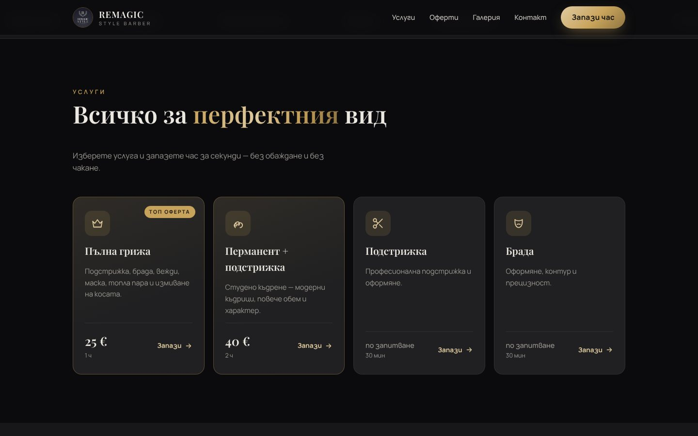
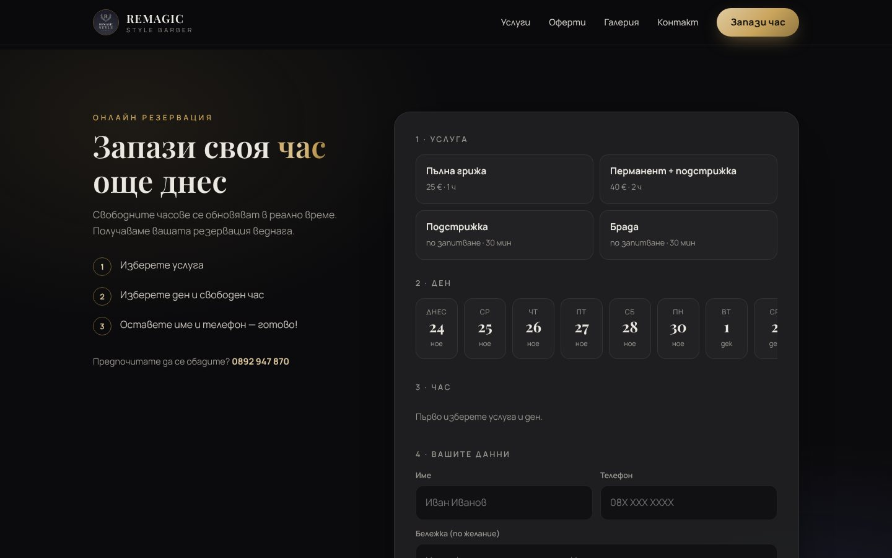
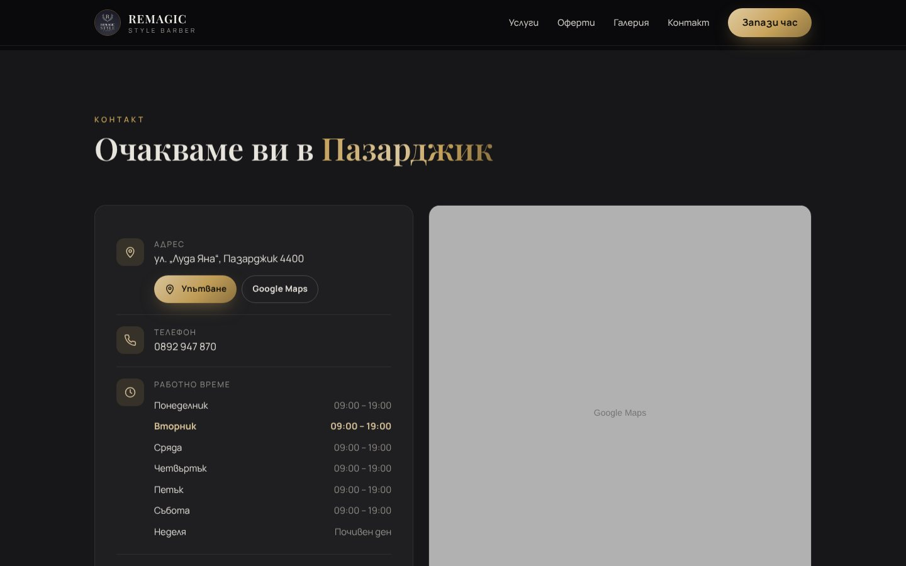
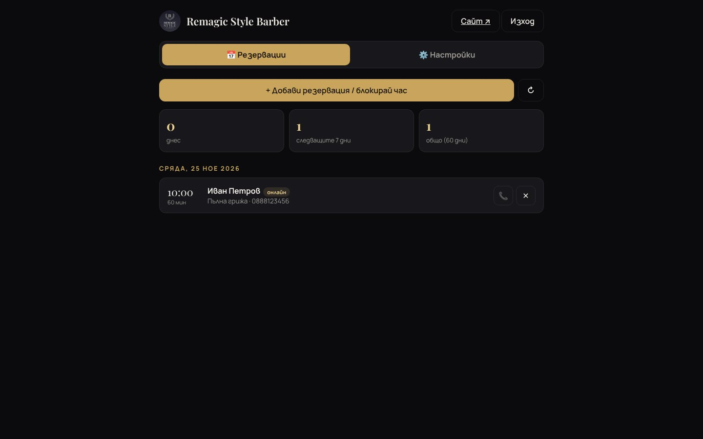

# Barber Booking – Website + Online Reservations

A website template for barbershops with **online booking**, **instant Telegram notifications** to the barber and an **admin panel**. Everything runs as a single **Cloudflare Worker** with a **D1** (SQLite) database, so hosting is free for a small business.

The first site built with it is a demo for **Remagic Style Barber** (Pazardzhik, Bulgaria). I showed it to the owner and he liked it, but it is not in daily use yet.

**Live demo:** https://berber.zeminmedia.workers.dev


<p>
  
  
</p>
<p>
  
  
</p>
<p>
  
  
  
</p>

## How a booking works

```
Customer picks a service ─► picks a day ─► sees only the free times ─► enters name + phone
        │
        ▼
Worker checks the slot again and saves it in D1 (no double bookings)
        │
        ├─► Customer sees "Done!" with the booking details
        └─► Barber gets a Telegram message:

            💈 НОВА РЕЗЕРВАЦИЯ
            🏪 Remagic Style Barber
            📅 Сряда, 25 ное 2026
            🕐 10:00 (60 мин)
            ✂️ Пълна грижа — 25 €
            👤 Иван Петров
            📞 0888123456
```

## Features

**For customers**
- Choose a service, a day and a free time slot. Busy times and times too short for the chosen service are hidden.
- Mobile-first design with a sticky "Book" and "Call" bar on phones.
- Contact section with working hours, map and directions.

**For the barber (admin panel at `/admin`)**
- List of upcoming bookings, with call and cancel buttons.
- Add a booking that came by phone, or block a time (lunch, day off).
- Change everything without code: name, logo, colors, services and prices, offer box, gallery, working hours, number of chairs, FAQ, SEO texts.
- Export / import settings, so a new barbershop can be set up in about 15 minutes.

**Under the hood**
- **No double bookings:** the slot is checked and saved in one atomic database query, so if two people book the same time, only one succeeds.
- **Number of chairs:** with 2 barbers, two bookings can share the same time.
- **Time zone aware** (Europe/Sofia), minimum notice time and maximum days ahead.
- **SEO:** structured data for Google (address, hours, prices), FAQ, `robots.txt`, `sitemap.xml`.
- **Spam protection:** hidden honeypot field in the form.
- **Secrets stay out of the code:** admin password, Telegram bot token and chat ID are Cloudflare secrets (see `.dev.vars.example`).

## Tech

- Cloudflare Workers (JavaScript) + D1 (SQLite)
- Telegram Bot API for notifications
- HTML, CSS and vanilla JavaScript (no framework)
- A small Node build script that bundles the pages and a client "preset" (settings + photos) into one `worker.js`

## Project structure

```
src/
  worker.js         API (slots, booking, admin) and page rendering
  booking.js        Time-slot logic: working hours, overlaps, free times
  index.src.html    Public website
  admin.html        Admin panel
presets/
  default/          Empty template ("Barber Shop" sample data)
  remagic/          Remagic's settings and photos
build.mjs           node build.mjs <preset>  →  dist/<preset>/worker.js
dist/               Ready-to-deploy workers
wrangler.jsonc      Cloudflare config (no secrets inside)
```

## Run your own

1. Create a D1 database and put its ID in `wrangler.jsonc`.
2. Build: `node build.mjs remagic` (or `default`).
3. Add the secrets in Cloudflare → Worker → Settings → Variables and Secrets: `ADMIN_PASSWORD`, `TELEGRAM_BOT_TOKEN`, `TELEGRAM_CHAT_ID`.
4. Deploy: `npx wrangler deploy`. The database tables are created automatically on the first request.
5. Open `/admin`, log in, and fill in the business details, services, prices and working hours in **⚙️ Настройки**.

## Credits

Idea, design and client work by **Muhammed Selim / ZeminMedia**. The code was written with AI assistance (Claude).
Photos and logo belong to Remagic Style Barber.
